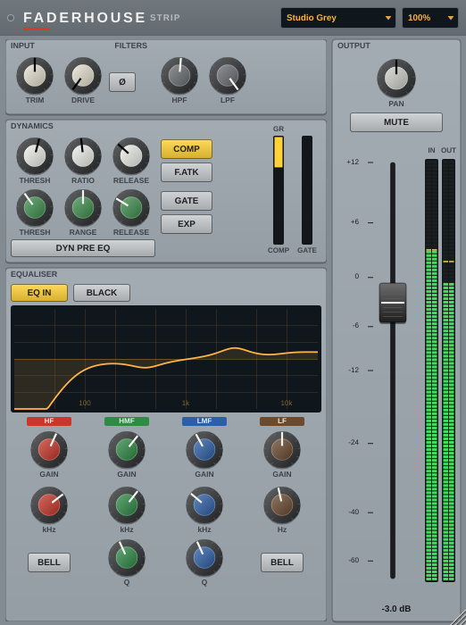

# Faderhouse

A 16-channel console in the style of a classic British large-format desk, as a
VST3 plugin (AU on macOS) and a Standalone app, plus **Faderhouse Strip**, one
channel of the desk as an insert plugin for a single DAW track. In the Standalone app each
channel can take an audio-interface input or host its own VST3 instrument
played from your MIDI keyboard, and every channel, FX return and the mix bus
can host VST3 effects. Built with JUCE 8 and CMake.

## What's on the desk

- **16 channel strips**, each with: source (interface input, stereo pair, or
  hosted instrument with its own MIDI channel), input trim, drive (soft
  saturation), phase invert, 18 dB/oct high-pass and 12 dB/oct low-pass
  filters, compressor (threshold, ratio up to inf:1, release, fast attack,
  auto make-up), gate/expander (threshold, range, release), four-band EQ
  (HF and LF shelf or bell, two fully parametric mids, "brown" constant-Q or
  "black" proportional-Q mode), dynamics pre/post EQ, up to 6 VST3 inserts
  (pre or post processing), 4 aux sends (each pre or post fader), pan, solo
  (in place), mute, 100 mm-style fader, peak meter and a nameable scribble strip.
- **4 FX returns** (A to D), each with its own VST3 chain, return level,
  balance and mute. Returns are solo-safe.
- **Mix bus**: up to 6 VST3 inserts, then a stereo bus compressor (stepped
  ratio 2/4/10, attack 0.1 to 30 ms, release 0.1 to 1.2 s or Auto, make-up,
  parallel mix) and the master fader.
- **Channel panel**: click SEL (or a scribble strip) to show that channel's
  routing, inserts, input, filters, dynamics and EQ with a live EQ curve.
- **5 themes**: Studio Grey, Black Session, Cream Classic, Midnight, Daylight.
  Window sizes 60 to 115% plus free resize.

- **Plugin delay compensation**: hosted plugins that add latency are lined
  up automatically. Every channel is delayed to match the slowest channel,
  the dry mix waits for the slowest FX return, and the total (shown as PDC in
  the master section) is reported to the DAW so the desk stays in time with
  the rest of the session.

Right-click a send knob for pre/post fader. Double-click any control to reset
it, double-click a scribble strip to rename the channel. Everything, including
hosted plugins and their settings, is saved with the session.

## Faderhouse Strip

The same input stage, filters, compressor, gate and four-band EQ as a desk
channel, plus pan, output fader and in/out meters, as a VST3 (and AU) insert.
Mono or stereo tracks; adds no latency. Uses the same 5 themes.



## Standalone vs plugin

| | Standalone | Plugin |
|---|---|---|
| Channel inputs | Up to 16 audio-interface inputs (Options > Audio/MIDI settings) | Main stereo input, plus 7 optional stereo inputs the DAW can feed (sidechain-style buses "In 3/4" ... "In 15/16") |
| Instruments | Any VST3 instrument per channel, played from MIDI input | Works too (MIDI from the track) |
| Hosts it was written for | Runs on its own | Any VST3 host, including the Max Sample desktop companion |
| Default routing | Channel *n* = interface input *n* | Channel 1 = main input, channels 2 to 8 = the extra inputs |

The Standalone app starts with its audio input muted to avoid feedback; click
the banner (or Options) to unmute.

## Installers (Mac and Windows)

Every push to GitHub builds both installers in GitHub Actions
(`.github/workflows/build.yml`), after the engine tests pass on Linux.
Download them from the run's **Artifacts**, or push a tag like `v0.2.0` to
publish them on a Release page.

| File | Who it's for | What it installs |
|---|---|---|
| `Faderhouse-<ver>-mac.dmg` | macOS 10.15+ (incl. Big Sur on Intel), Intel and Apple Silicon | `.pkg`: Faderhouse VST3, AU, Standalone app; Faderhouse Strip VST3 + AU |
| `Faderhouse-<ver>-windows-setup.exe` | Windows 10/11, 64-bit | Both VST3s into `C:\Program Files\Common Files\VST3`, optional Standalone app |

The builds aren't code-signed yet: on Mac right-click the .pkg and choose
**Open**; on Windows click **More info > Run anyway**.

## Build

```sh
cmake -B build -DCMAKE_BUILD_TYPE=Release        # fetches JUCE 8.0.4
cmake --build build --config Release
ctest --test-dir build -C Release --output-on-failure
```

Outputs: `build/Faderhouse_artefacts/Release/` (`VST3/Faderhouse.vst3`,
`Standalone/`, `AU/` on macOS) and `build/FaderhouseStrip_artefacts/Release/`
(`VST3/Faderhouse Strip.vst3`, `AU/` on macOS). `-DJUCE_DIR=/path/to/JUCE` uses a local JUCE.
`-DFH_BUILD_TOOLS=OFF` skips the tests and tools.

macOS builds target 10.15+ as a universal binary (Intel and Apple Silicon),
so they run on macOS 11 on Intel Macs; nothing uses AVX or AVX2. Windows
builds use the static runtime. Linux needs `libasound2-dev libx11-dev
libxrandr-dev libxinerama-dev libxcursor-dev libfreetype-dev
libfontconfig1-dev libgl1-mesa-dev`.

### Tests and tools (`FH_BUILD_TOOLS`, on by default)

- `EngineTests`: runs the console like a DAW would and checks gain staging,
  pan laws, mute/solo, filters, EQ, compressor, gate, sends, bus compressor,
  state save/restore, hosting, latency compensation and the Strip plugin,
  using three tiny test plugins built alongside (`TestHalfGain.vst3`,
  `TestDelay.vst3` with 480 samples of latency, `TestSineSynth.vst3`).
- `Snapshots <dir>`: renders PNGs of the console in every theme and of the Strip
  (`xvfb-run` on a headless Linux box).

## Layout

```
Source/PluginProcessor.*      buses, routing, solo/mute, sends, returns, mix bus, state
Source/engine/Params.*        all parameter IDs and ranges
Source/engine/ChannelStrip.*  input stage, filters, dynamics, EQ
Source/engine/BusCompressor.* mix bus compressor
Source/engine/Biquad.h        filters and the EQ design shared with the UI curve
Source/engine/DelayLine.h     delay used for plugin latency compensation
Source/strip/*                Faderhouse Strip (single channel plugin)
Source/hosting/HostedChain.*  VST3 chains (inserts or one instrument) on AudioProcessorGraph
Source/ui/*                   look and feel, themes, strips, channel panel, master, plugin windows
tools/                        tests, test plugins, screenshot renderer
```

See [docs/DESIGN.md](docs/DESIGN.md) for the design notes and roadmap.
